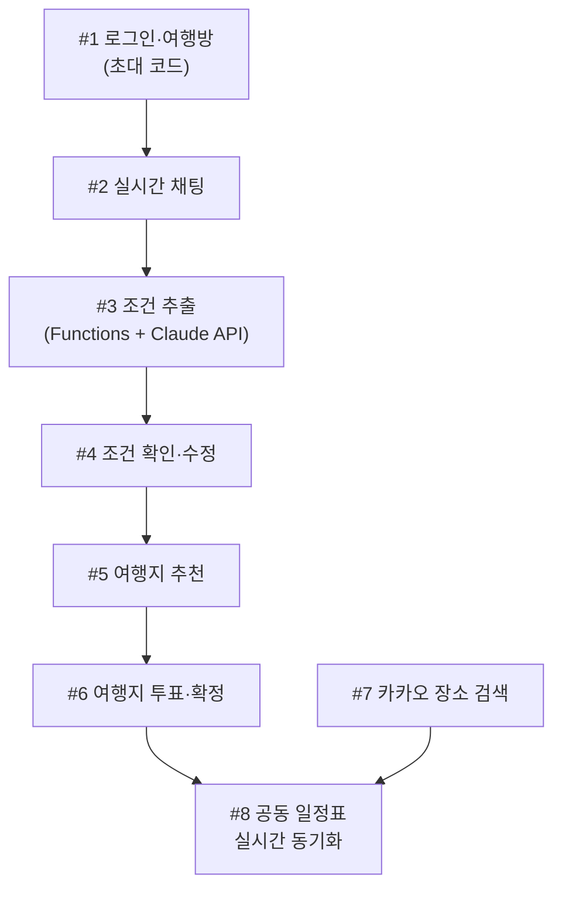

# 5주차 활동지 / Week 5 Worksheet

**1-page 기획서 / One-page plan**

- 작성일 / Date: 2026-09-30
- 수정일 / Revised: 2026-11-11 (9주차 주제 변경에 따라 여행 계획 앱 기준으로 재작성)
- 참여자 / Present: 김현우, 박영욱

---

## ① 주제 확정 / Confirm topic

- 확정 주제 / Topic: 친구들의 채팅에서 여행 조건을 뽑아 여행지를 추천하고 일정을 함께 결정하는 여행 계획 어플리케이션.
- 이유 / Reason: 단체 채팅방에 흩어지는 여행 조건과 의견을 한곳에 모아 함께 결정하는 과정을 돕기 위함.

---

## ② 태스크 분해와 의존 관계 / Tasks and dependencies

### 태스크 목록 / Task list

4주차 사용자 스토리와 완료 조건을 태스크로 나눕니다.
*Break down your Week 4 user stories and acceptance criteria into tasks.*

친구들이 여행방에서 채팅하면 대화 속 조건을 추출하고, 조건에 맞는 여행지를 추천해 투표로 확정한 뒤 공동 일정표를 만든다.

*Each task must be checkable on its own. Do not write "everyone" as owner.*

| # | 태스크 Task | 완료 조건 Done when | 선행 태스크 Depends on | 담당 Owner |
|---|---|---|---|---|
| 1 | 로그인, 여행방 생성, 6자리 초대 코드 참여 | 계정 2개로 로그인해 한쪽이 만든 여행방에 다른 쪽이 초대 코드로 들어가면 양쪽 멤버 목록에 2명이 표시됨 | - |김현우|
| 2 | 여행방 실시간 채팅 | 기기 2대에서 메시지를 보내면 양쪽 채팅 화면에 표시되고, 하단 채팅 아이콘으로 어느 화면에서든 열고 닫을 수 있음 | 1 |김현우|
| 3 | 채팅 조건 추출 (Cloud Functions + Claude API) | 조건이 담긴 메시지를 보내면 인원·날짜·출발지·이동수단·예산·활동이 JSON으로 저장되고 출처 메시지가 연결됨 | 2 |박영욱|
| 4 | 조건 확인·수정 화면 | 추출된 조건이 출처와 함께 표시되고, AI가 추측한 항목이 구분되며, 수정 내용이 저장됨 | 3 |김현우|
| 5 | 조건 기반 여행지 추천 | 저장된 조건으로 추천을 요청하면 국내 여행지 3곳과 이유가 표시됨 | 4 |박영욱|
| 6 | 여행지 투표와 확정 | 멤버별 1표로 투표하고 과반 득표 여행지를 방장이 확정하면 여행방에 반영됨 | 5 |김현우|
| 7 | 카카오 장소 검색 | 키워드로 검색하면 장소명, 주소, 좌표가 목록에 표시됨 | - |박영욱|
| 8 | 공동 일정표 실시간 동기화 | 기기 2대에서 장소 추가·순서 변경이 5초 이내에 양쪽에 동일하게 반영됨 | 6, 7 |박영욱|

### 의존 관계 그래프 / Dependency graph (DAG)
화살표는 "앞 태스크가 끝나야 뒤 태스크를 할 수 있다"는 뜻입니다.
*An arrow means the first task must finish before the second can start.*

**그리는 방법 / How to draw**
- 아래 예시에서 상자 이름을 바꾸고, 선후 관계 하나마다 화살표(`-->`) 줄을 하나씩 추가합니다. GitHub에서 파일을 열면 그림으로 보입니다. 미리 보려면 mermaid.live에 붙여 넣으세요.
  *Rename the boxes and add one `-->` line per dependency. GitHub shows it as a diagram. Preview at mermaid.live.*
- 태스크 표를 AI에게 주고 "Mermaid 그래프로 바꿔 줘"라고 요청해도 됩니다.
  *You can also give the task table to AI and ask "Convert this into a Mermaid graph."*
- 어려우면 종이에 그려 사진을 `docs/images/`에 올리고 ``로 넣어도 됩니다.
  *Or draw it on paper, upload the photo to `docs/images/` and link it with ``.*

- 지금 착수 가능 (진입 차수 0) / Can start now (in-degree 0): #1, #7
- 작업 순서 (위상정렬) / Work order (topological sort): #1 → #7 → #2 → #3 → #4 → #5 → #6 → #8
- 사이클이 있었다면 어떻게 풀었는가 / If there was a cycle, how did you fix it?: 사이클 없음

---

## ③ 범위 결정 / Scope

### Must — 없으면 성립 안 됨 / essential

핵심 시나리오 1개가 끝까지 동작하는 데 필요한 것만 / *Only what the core scenario needs to work end-to-end*

- 핵심 시나리오 / Core scenario: 

 친구들이 여행방을 만들어 채팅하면, 시스템이 대화에서 인원·날짜·출발지·이동수단·예산을 추출하고, 조건에 맞는 여행지를 추천한다. 멤버 투표로 여행지를 확정하면 공동 일정표에서 장소를 함께 추가하고 실시간으로 확인한다.

### Should (없을 경우에는 작성하지 마세요)

 - 시나리오: 멤버들이 장소를 후보함에 담아 찬성/보통/반대로 투표하고 댓글을 남긴 뒤 일정표로 옮긴다. 다른 곳에서 예약한 항공·숙소 정보를 수동으로 입력해 일정표 상단에서 본다.

### Could (없을 경우에는 작성하지 마세요)

 - 시나리오: 예약 확인 메일을 붙여넣으면 AI가 항공·숙소 카드로 변환한다. 투표가 갈리면 AI가 절충안을 제안한다. 준비물 체크리스트와 1/N 가계부를 사용한다.

### **Won't — 이번 학기에 안 함 / not this semester**

| Won't 항목 Item | 포기한 이유 Why |
|---|---|
| 숏폼 영상 기반 일정 빌더 | 영상 데이터를 합법적으로 확보할 방법이 없음 |
| 게임화·미니룸, 포인트·상품권 보상 | 한 학기 안에 구현하기 어렵고, 학생 프로젝트에서 금전 보상을 제공할 수 없음 |
| 편명 입력 자동 비행 정보 조회 | 항공 데이터 API가 대부분 유료임 |
| 해외 여행 지원 | 지도 SDK를 두 개 유지해야 하므로 국내(카카오)로 한정함 |

### 실행 가능성 확인 / Feasibility check

- 특수 장비·유료 API·실제 개인정보가 필요한가? 필요하다면 대안은?
  *Does it need special hardware, paid APIs or real personal data? If so, what is the alternative?*
  Cloud Functions 배포에 Firebase 종량제(Blaze) 전환과 카드 등록이 필요하고 Claude API는 유료임. 사용량이 작은 시연 규모로 제한하고 예산 알림을 설정함. 실제 개인정보 대신 시연용 가상 대화와 계정을 사용함.
- 15주차에 발표장에서 시연할 수 있는 형태인가?
  *Can it be demonstrated live in Week 15?*
  시연할 수 있음. 기기 2대로 "3명이 제주 2박 3일을 계획하는 상황"을 재현하고, 네트워크나 API 장애에 대비해 사전 녹화 영상을 준비함.

---

## ④ 가장 먼저 동작시킬 흐름 (Walking Skeleton) / First end-to-end flow

예 / Example: 과제 ID를 입력하면 → LMS에서 제출 기록을 받아 와서 → 화면에 제출 인원 숫자 하나가 뜬다
> [멤버가 여행방 채팅에 조건을 입력하면] → [Cloud Functions가 Claude API로 조건을 추출해 Firestore에 저장해서] → [조건 확인 화면에 추출된 조건 하나가 출처와 함께 뜬다]

---

> 수업 종료 시 커밋하세요 / Commit this at the end of class
> `git add docs/week-05.md && git commit -m "docs: 5주차 활동지 작성"`
