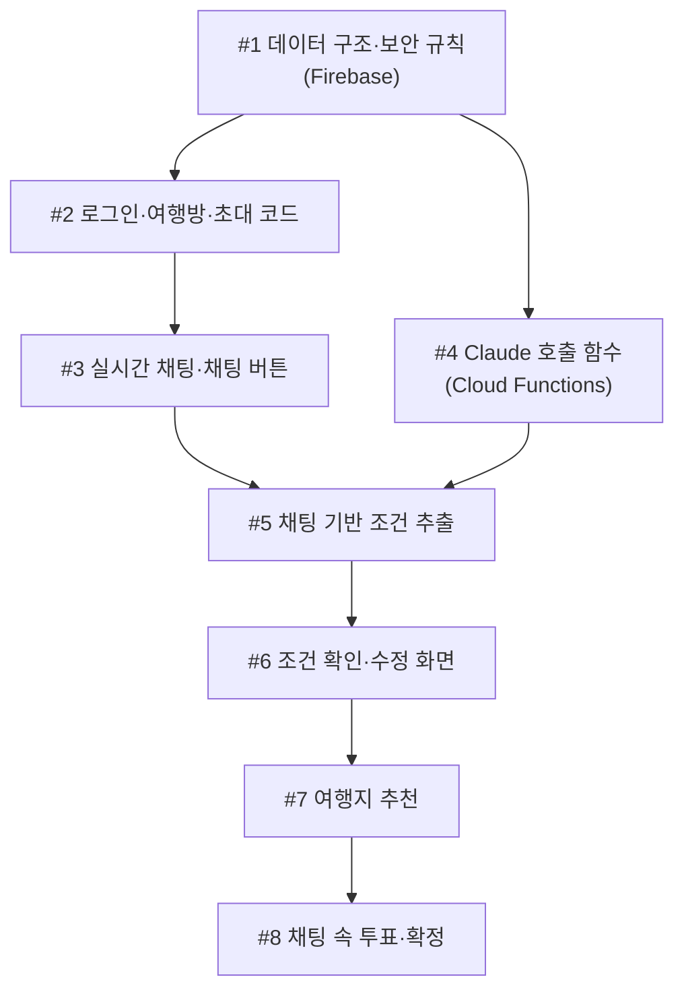

# 5주차 활동지 / Week 5 Worksheet

**1-page 기획서 / One-page plan**

- 작성일 / Date: 2026-09-30
- 참여자 / Present: 김현우, 박영욱

---

## ① 주제 확정 / Confirm topic

- 확정 주제 / Topic: 친구들이 여행방에서 채팅하면 AI가 대화 속 여행 조건을 정리해 여행지를 추천하고, 채팅 안에서 함께 투표해 정하는 여행 계획 앱
- 이유 / Reason: 여러 명이 함께 여행을 계획할 때 의견이 단톡방 메시지 사이에 흩어져 한 사람이 정리를 떠맡고 결정이 미뤄지는 문제를, 대화하는 곳과 정하는 곳을 한 앱으로 합쳐 줄이기 위함.

---

## ② 태스크 분해와 의존 관계 / Tasks and dependencies

### 태스크 목록 / Task list

4주차 사용자 스토리와 완료 조건을 태스크로 나눕니다.
*Break down your Week 4 user stories and acceptance criteria into tasks.*

여행방 멤버가 채팅으로 여행 조건을 이야기하면, AI가 조건을 정리하고 그 조건으로 여행지를 추천하며, 멤버들이 채팅 안에서 투표해 여행지를 확정한다. (4주차 AC-1~AC-6)

*Each task must be checkable on its own. Do not write "everyone" as owner.*

| # | 태스크 Task | 완료 조건 Done when | 선행 태스크 Depends on | 담당 Owner |
|---|---|---|---|---|
| 1 | Firebase 프로젝트, 데이터 구조(여행방·멤버·메시지·조건), 보안 규칙 만들기 | 멤버가 아닌 계정으로 여행방 문서와 메시지를 읽으면 거부되고, 멤버 계정으로는 읽힌다 (AC-5) | - | 김현우 |
| 2 | 로그인, 여행방 만들기, 6자리 초대 코드로 참여 | 기기 2대에서 한 명이 방을 만들고 다른 한 명이 코드를 입력하면 두 화면의 멤버 목록에 2명이 보인다 | 1 | 박영욱 |
| 3 | 여행방 실시간 채팅과 오른쪽 아래 채팅 버튼(채팅 시트) | 한 기기에서 보낸 메시지가 3초 안에 다른 기기에 보이고, 어느 화면에서든 채팅 버튼으로 채팅을 열고 닫으면 보던 화면으로 돌아온다 | 2 | 박영욱 |
| 4 | Claude API를 호출하는 Cloud Function | 앱 코드와 APK에 API 키가 없고, 앱에서 함수를 호출하면 정해진 JSON 형식으로 응답이 온다 | 1 | 김현우 |
| 5 | 채팅 기반 여행 조건 추출 | 시연용 메시지 4개를 보내면 30초 안에 조건 바에 조건 5개와 근거 메시지가 표시되고, 대화에 없는 출발지는 '확인 필요'로 표시된다 (AC-1, AC-4, AC-6) | 3, 4 | 김현우 |
| 6 | 조건 확인·수정 화면 | 조건 하나를 고치고 나갔다 다시 들어와도 고친 값이 유지되고, 다른 멤버 화면에도 같은 값이 보인다 | 5 | 박영욱 |
| 7 | 기본 추천과 조건 기반 여행지 추천 | 조건이 없을 때는 기본 추천 3곳, 조건 확인 후에는 15초 안에 3곳이 조건 수·이유와 함께 표시된다 (AC-2) | 6 | 김현우 |
| 8 | 채팅 속 여행지 투표와 확정 | 추천을 투표 카드로 채팅에 올리고 3명이 투표한 뒤 방장이 확정하면 5초 안에 모든 기기에 여행지가 표시된다 (AC-3) | 7 | 박영욱 |

### 의존 관계 그래프 / Dependency graph (DAG)
화살표는 "앞 태스크가 끝나야 뒤 태스크를 할 수 있다"는 뜻입니다.
*An arrow means the first task must finish before the second can start.*

**그리는 방법 / How to draw**
- 아래 예시에서 상자 이름을 바꾸고, 선후 관계 하나마다 화살표(`-->`) 줄을 하나씩 추가합니다. GitHub에서 파일을 열면 그림으로 보입니다. 미리 보려면 mermaid.live에 붙여 넣으세요.
  *Rename the boxes and add one `-->` line per dependency. GitHub shows it as a diagram. Preview at mermaid.live.*
- 태스크 표를 AI에게 주고 "Mermaid 그래프로 바꿔 줘"라고 요청해도 됩니다.
  *You can also give the task table to AI and ask "Convert this into a Mermaid graph."*
- 어려우면 종이에 그려 사진을 `docs/images/`에 올리고 ``로 넣어도 됩니다.
  *Or draw it on paper, upload the photo to `docs/images/` and link it with ``.*

- 지금 착수 가능 (진입 차수 0) / Can start now (in-degree 0): #1
- 작업 순서 (위상정렬) / Work order (topological sort): #1 → #2 → #4 → #3 → #5 → #6 → #7 → #8 (#2·#3과 #4는 서로 의존하지 않아서, 박영욱이 #2·#3을 하는 동안 김현우가 #4를 동시에 진행)
- 사이클이 있었다면 어떻게 풀었는가 / If there was a cycle, how did you fix it?: 처음에는 "추천에 필요한데 아직 대화에 안 나온 조건을 AI가 채팅방에 되묻는 기능"을 #5에 넣으려 했음. 그러면 #5(조건 추출)가 #7(추천)이 무엇을 필요로 하는지 알아야 하고, #7은 #5의 결과가 있어야 해서 #5 ↔ #7 사이클이 생김. AI가 찾을 조건을 6가지(날짜·기간, 인원, 출발지, 이동수단, 예산, 하고 싶은 것)로 미리 고정해, #5가 #7에 의존하지 않도록 풀었음.

---

## ③ 범위 결정 / Scope

### Must — 없으면 성립 안 됨 / essential

핵심 시나리오 1개가 끝까지 동작하는 데 필요한 것만 / *Only what the core scenario needs to work end-to-end*

- 핵심 시나리오 / Core scenario: 

 친구 3명이 초대 코드로 같은 여행방에 모여 채팅하면, AI가 대화에서 날짜·기간·인원·이동수단·예산·하고 싶은 것을 근거 메시지와 함께 정리하고, 멤버가 조건을 확인하면 그 조건에 맞는 여행지 3곳을 추천하며, 멤버들이 채팅 안에서 투표해 한 곳을 확정한다. (태스크 #1~#8)

### Should (없을 경우에는 작성하지 마세요)
 
 - 여행지가 정해진 뒤 가고 싶은 장소를 후보함에 담고(카카오 장소 검색), 장소마다 찬성/보통/반대 투표와 댓글을 남겨 과반이 찬성한 장소를 고른다.
 - 고른 장소를 일차별 일정표로 옮기고, 지도에서 그날 동선을 번호 마커와 선으로 본다. 여러 명이 동시에 순서를 바꿔도 모든 기기에 같은 일정이 보인다.

### Could (없을 경우에는 작성하지 마세요)

 - 다른 곳에서 예약한 항공·숙소 확인 메일을 붙여넣으면 AI가 예약 카드로 정리해 일정표 맨 위에 둔다.
 - 대기실에서 친구가 들어올 때마다 캐리어가 쌓이는 연출, 총무·길잡이 같은 역할과 할 일 체크리스트.

### **Won't — 이번 학기에 안 함 / not this semester**

| Won't 항목 Item | 포기한 이유 Why |
|---|---|
| 친구 초대 시 포인트·상품권 지급, 추첨 여행 지원금 | 학생 프로젝트에서 실제 돈이나 상품을 줄 수 없음 |
| 숏폼 영상을 넘겨보며 장소를 담는 일정 빌더 | 장소별 영상 데이터를 모을 방법이 없고 저작권 문제가 있음 |
| 뚜벅이·운전자 맞춤 동선(주차장, 경사도, 버스 배차) | 실시간 주차·경사 데이터가 필요하고 한 학기 안에 검증할 수 없음 |
| 편명만 넣으면 비행 정보 자동 등록, 예약 메일 자동 전달·OCR | 항공 데이터 API는 대부분 유료이고 메일 수신 서버가 따로 필요함 |
| 구글 문서 수준의 동시 편집 엔진(CRDT·WebSocket 직접 구현) | 이것만으로 한 학기 분량이라, Firestore 실시간 동기화로 대신함 |
| 해외 여행 지원 | 국내는 카카오, 해외는 구글 지도를 따로 붙여야 해서 국내로 한정함 |
| 여행지 후보를 각자 손으로 올리고 투표하는 흐름 (10주차 추가) | 사용자가 따로 입력해야 해서 단톡방에서 하던 일을 한 번 더 하게 됨 → 채팅에서 조건을 찾아 추천하는 방식으로 대체 |
| 화면을 반으로 나눈 일정표 + 미니 톡방 (10주차 추가) | 휴대폰 화면에서 양쪽 다 너무 좁아짐 → 오른쪽 아래 채팅 버튼과 채팅 시트로 대체 |

### 실행 가능성 확인 / Feasibility check

- 특수 장비·유료 API·실제 개인정보가 필요한가? 필요하다면 대안은?
  *Does it need special hardware, paid APIs or real personal data? If so, what is the alternative?*
  Claude API는 유료(사용량 과금)이고, Cloud Functions를 배포하려면 Firebase 종량제(Blaze) 요금제와 카드 등록이 필요함. 개발 중에는 Firebase 에뮬레이터로 로컬에서 테스트하고, 조건 추출처럼 단순한 작업은 저렴한 모델을 쓰고, 예산 알림을 걸어 비용을 관리함. 카카오 지도·로컬 API는 무료 사용량 안에서 충분함. 채팅 내용은 개인정보이므로 개발과 시연에는 팀원·테스트 계정과 시연용 가짜 대화만 사용하고, 실제 친구들의 대화는 넣지 않음.
- 15주차에 발표장에서 시연할 수 있는 형태인가?
  *Can it be demonstrated live in Week 15?*
  시연할 수 있음. 휴대폰 3대(또는 실기기 1대 + 에뮬레이터 2대)에 팀원 2명과 테스트 계정 1개로 로그인해, 미리 정한 대화 스크립트를 보내면서 조건 정리 → 추천 → 투표 → 확정을 보여주면 됨. AI 응답이 늦어질 때를 대비해 같은 흐름을 녹화한 영상을 준비함.

---

## ④ 가장 먼저 동작시킬 흐름 (Walking Skeleton) / First end-to-end flow

예 / Example: 과제 ID를 입력하면 → LMS에서 제출 기록을 받아 와서 → 화면에 제출 인원 숫자 하나가 뜬다
> [친구 2명이 같은 여행방에서 "금요일 저녁에 출발해서 일요일에 오자", "바다 보고 싶다" 메시지를 보내면] → [Cloud Function이 대화를 Claude에 보내 조건 JSON을 받아 Firestore에 저장해서] → [채팅방 상단 조건 바에 "2명 · 2박 3일 · 바다"가 뜬다]

---

> 수업 종료 시 커밋하세요 / Commit this at the end of class
> `git add docs/week-05.md && git commit -m "docs: 5주차 활동지 작성"`
