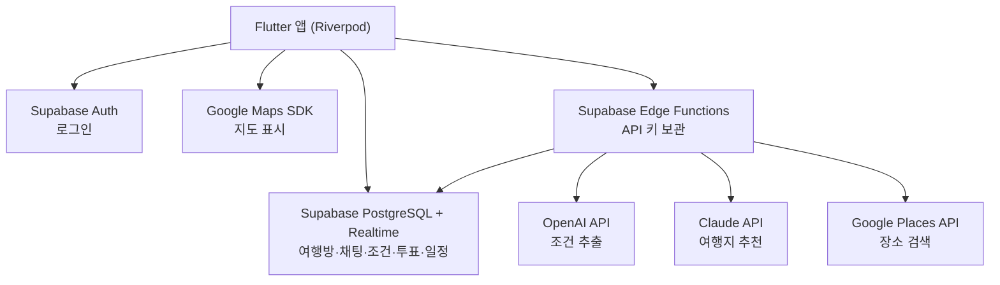

# Week 07 팀 활동지 / Team Activity

| 팀명 / Team | 작성일 / Date | 참여자 / Members |
|---|---|---|
|패트와매트|2026.10.14 (수정 2026.11.11, 9주차 주제 변경 및 Supabase·AI·지도 구성 변경 반영)|김현우, 박영욱|

## 1. 아키텍처 다이어그램 / Architecture Diagram

손그림 사진을 올리고 링크하십시오 / Upload a photo and link it.

| 계층 / Layer | 모듈·파일 / Modules | 의존하지 않는 것 / Does not depend on |
|---|---|---|
| 표현 / Presentation | login_screen(로그인), trip_list_screen(여행방 목록), create_trip_screen(여행방 생성), join_screen(초대 코드 입력), trip_chat_sheet(채팅 오버레이), conditions_screen(조건 확인·수정), recommendation_screen(여행지 추천), destination_vote_screen(투표·확정), itinerary_screen(공동 일정표), app_theme | Supabase 테이블 구조, AI 프롬프트, Google API 호출 방식 |
| 로직 / Logic | Riverpod provider(AuthState, TripState, ChatMessages, TripConditions, Recommendations, VoteState, Itinerary), invite_code_service(코드 생성·검증), vote_engine(1인 1표, 과반 판정), itinerary_controller(일차별 장소 추가·순서 변경) | 화면 구성(위젯), 저장소 종류, 외부 API SDK |
| 데이터 / Data | trip_repository, chat_repository, condition_repository, vote_repository, itinerary_repository(Supabase), google_place_service(Edge Function을 거쳐 Google Places API 호출), ai_functions_client(Edge Functions 호출), functions/analyze-chat(OpenAI API), functions/recommend-destinations(Claude API), functions/_shared/ai(제공자 선택·응답 검증, 키는 서버에만 보관) | 투표 판정 규칙, 화면 상태, 위젯 |

## 2. 이슈 / Issues

> 이슈 = **앞으로 할 일** / An issue is work to be done.
> 개발할 때 커밋에 이슈 번호를 붙이고(`#3 알레르기 필터 추가`), 완료 조건을 만족하면 이슈를 닫습니다.
> Add the issue number to commits, and close the issue when its criteria are met.

| # | 제목 / Title | 라벨 / Label | 담당 / Assignee | 완료 조건 / Acceptance Criteria |
|---|---|---|---|---|    
| #1 | 데이터 스키마와 보안 규칙 | backend | 박영욱 | 여행방·멤버·채팅·조건·투표·일정 구조를 저장할 수 있고, 멤버가 아닌 계정은 해당 여행방을 읽거나 쓸 수 없다 |
| #2 | 로그인과 여행방 생성 | frontend | 김현우 | 로그인 후 여행방을 만들면 6자리 초대 코드가 표시되고 앱을 다시 켜도 여행방이 목록에 남아 있다 |
| #3 | 초대 코드로 참여 | backend | 박영욱 | 다른 계정이 올바른 코드를 입력하면 멤버로 추가되고, 틀린 코드는 오류 안내가 뜬다 |
| #4 | 실시간 채팅과 오버레이 | frontend | 김현우 | 기기 2대에서 보낸 메시지가 양쪽에 표시되고, 하단 채팅 아이콘으로 현재 화면 위에서 채팅을 열고 닫을 수 있다 |
| #5 | 채팅 조건 추출 | backend | 박영욱 | "8월 둘째 주 2박 3일, 서울 출발, 차 1대, 1인 30만원"을 보내면 조건이 출처 메시지와 함께 저장되고, AI 호출 실패 시 임의로 저장하지 않는다 |
| #6 | 조건 확인·수정 화면 | frontend | 김현우 | 조건별 출처가 표시되고 AI가 추측한 항목이 구분되며, 수정한 값이 양쪽 기기에 반영된다 |
| #7 | 조건 기반 여행지 추천 | backend | 박영욱 | 저장된 조건으로 추천을 요청하면 국내 여행지 3곳과 각 추천 이유가 표시된다 |
| #8 | 여행지 투표와 확정 | frontend | 김현우 | 멤버당 1표만 반영되고, 과반 득표 여행지를 방장이 확정하면 여행방에 표시된다 |
| #9 | 구글 장소 검색 | data | 김현우 | "성산일출봉"을 검색하면 장소명, 주소, 좌표가 목록에 표시된다 |
| #10 | 공동 일정표 실시간 동기화 | data | 박영욱 | 기기 2대에서 장소 추가·순서 변경이 5초 이내에 양쪽에 동일하게 반영된다 |
| #11 | 세션 복구와 예외 처리 | data | 박영욱 | 오프라인에서도 마지막 일정을 볼 수 있고, 네트워크·AI 오류 시 안내 메시지가 뜬다 |
| #12 | APK 빌드와 README | docs | 김현우 | 릴리스 APK를 새 기기에 설치하면 #2~#10이 동작하고, README에 아키텍처와 시연 GIF가 있다 |

## 3. 마일스톤 / Milestones

| 마일스톤 / Milestone | 마감 / Due | 포함 이슈 / Issues |
|---|---|---|
| MVP 완료 | 11주차 | #1, #2, #3, #4, #5, #6, #7, #8, #9, #10 |
| 실행 패키지 | 13주차 | #11, #12 |

> AI를 사용했다면 `PROMPTS.md`에 기록 / Log any AI use in `PROMPTS.md`
