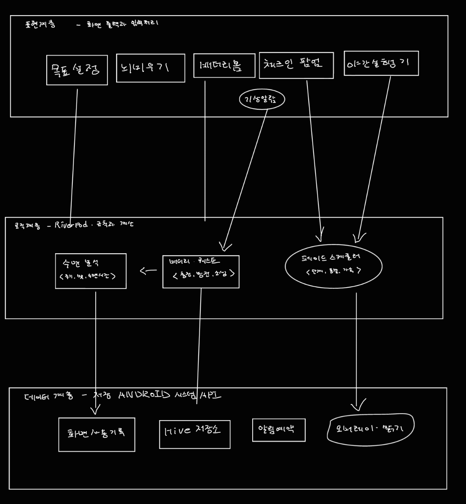

# Week 07 팀 활동지 / Team Activity

| 팀명 / Team | 작성일 / Date | 참여자 / Members |
|---|---|---|
|패트와매트|2026.10.14|김현우, 조영욱|

## 1. 아키텍처 다이어그램 / Architecture Diagram

손그림 사진을 올리고 링크하십시오 / Upload a photo and link it.

| 계층 / Layer | 모듈·파일 / Modules | 의존하지 않는 것 / Does not depend on |
|---|---|---|
| 표현 / Presentation | sleep_setup_screen(취침시간·수면 길이 설정), home_screen(수면 배터리·수면 빚), checkin_popup(감정 체크인), quest_screen(급속 충전·CPR 퀘스트), mind_dump_screen(뇌 비우기), alarm_screen(3초 롱프레스 기상), app_theme(정상·소생·방전 테마) | 오버레이·밝기 플러그인, Hive 저장 방식, 배터리·페이드 계산식 |
| 로직 / Logic | Riverpod provider(SleepGoal, BatteryState, CurrentMode, FadePhase), fade_scheduler(T-60/30/15/0 단계, 15분 동결, 가속 페이드), battery_engine(충전·방전, 소생·방전 판정), quest_engine(퀘스트 완료 판정), sleep_cycle_calc(90분 기상 추천), sleep_debt_calc(7일 수면 빚) | 화면 구성(위젯), 저장소 종류, 안드로이드 플러그인 |
| 데이터 / Data | sleep_repository(Hive: 수면 기록·메모·배터리), overlay_service(system_alert_window: 웜톤·흑백·다크레드 레이어), brightness_service(screen_brightness), foreground_service(flutter_foreground_task), alarm_service(기상 알람) | 페이드 단계 시각, 배터리 규칙, 퀘스트 조건, 수면 계산식 |

## 2. 이슈 / Issues

> 이슈 = **앞으로 할 일** / An issue is work to be done.
> 개발할 때 커밋에 이슈 번호를 붙이고(`#3 알레르기 필터 추가`), 완료 조건을 만족하면 이슈를 닫습니다.
> Add the issue number to commits, and close the issue when its criteria are met.

| # | 제목 / Title | 라벨 / Label | 담당 / Assignee | 완료 조건 / Acceptance Criteria |
|---|---|---|---|---|    
| #1 | 상태 스키마와 저장소 | backend | 팀원A | SleepGoal·BatteryState·CurrentMode·FadePhase를 저장하면 앱을 종료했다 다시 접속해도 값이 유지된다 |
| #2 | 수면 목표 설정 | frontend | 팀원A | 취침 23:30, 수면 7시간 30분을 입력하면 기상 07:00이 자동으로 표시된다 |
| #3 | 슬립 페이드 오버레이 | data | 팀원B | 다른 앱 사용 중에도 T-60분 웜톤, T-30분 흑백, 정각에 다크레드·최저 밝기로 바뀐다 |
| #4 | 감정 체크인과 15분 유예 | frontend | 팀원A | T-30분에 팝업이 뜨고, '멍때림' 선택은 바로 흑백, '억울해' 선택은 흑백 상태로 15분간 변화가 멈춘다 |
| #5 | 가속 페이드 | backend | 팀원B | 15분 유예 후 남은 15분 동안 2배 속도로 바뀌어 목표 취침 시각에 다크레드·최저 밝기에 도달한다 |
| #6 | 수면 배터리 엔진 | backend | 팀원B | 목표 달성 시 +25%, 미달 시 −30%가 반영되고, 20% 이하는 소생 모드, 0%는 방전 모드가 된다 |
| #7 | 소생·방전 테마와 퀘스트 | frontend | 팀원A | 배터리 15%에서 '30분 폰 내려놓기' 퀘스트를 완료하면 55%가 되고 테마가 정상으로 돌아온다 |
| #8 | 기상 알람 | data | 팀원B | 알람 화면을 3초 길게 누르면 알람이 꺼지고 어젯밤 수면 결과가 배터리에 반영된다 |
| #9 | 30초 뇌 비우기 | frontend | 팀원A | 머릿 속 생각이나 내일 할 일을 3줄 작성 후 '뇌 봉인하기'를 누르면 아침 알람이 꺼질 때까지 메모를 열 수 없다 |
| #10 | 수면 주기와 수면 빚 | backend | 팀원B | 23:00 취침 시 90분 단위 기상 추천(05:00, 06:30, 08:00)이 나오고, 최근 7일 부족 수면 합이 홈에 표시된다 |
| #11 | 세션 복구와 권한 예외 처리 | data | 팀원B | 앱을 강제 종료 후 다시 켜도 페이드 단계와 배터리가 이어지고, 권한 거부 시 안내 화면이 뜬다 |
| #12 | APK 빌드와 README | docs | 팀원A | 릴리스 APK를 새 기기에 설치하면 #2~#10이 동작하고, README에 아키텍처와 시연 GIF가 있다 |

## 3. 마일스톤 / Milestones

| 마일스톤 / Milestone | 마감 / Due | 포함 이슈 / Issues |
|---|---|---|
| MVP 완료 | 11주차 | #1, #2, #3, #4, #5, #6, #7, #8, #9, #10 |
| 실행 패키지 | 13주차 | #11, #12 |

> AI를 사용했다면 `PROMPTS.md`에 기록 / Log any AI use in `PROMPTS.md`
