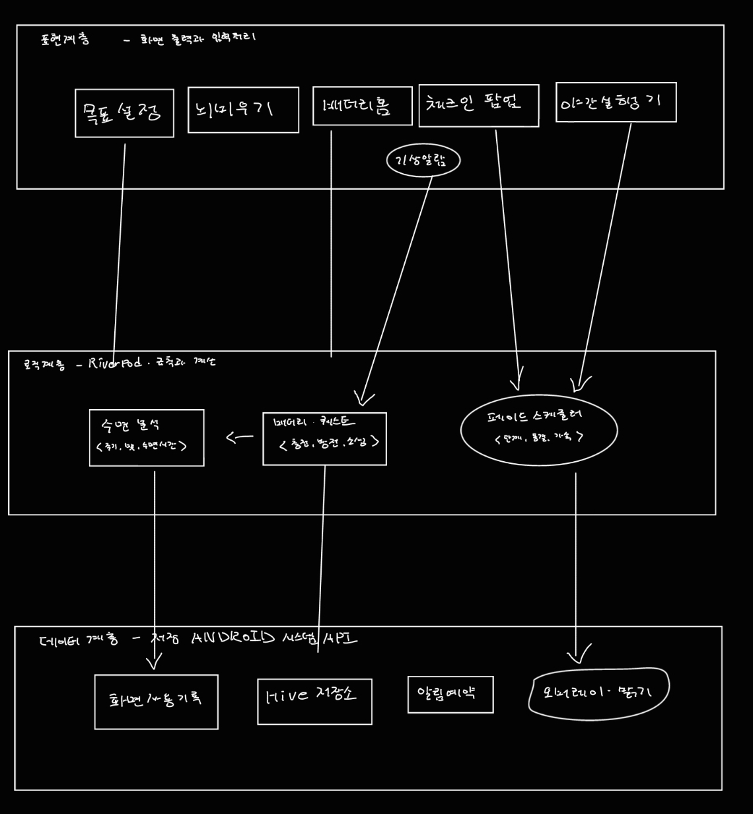
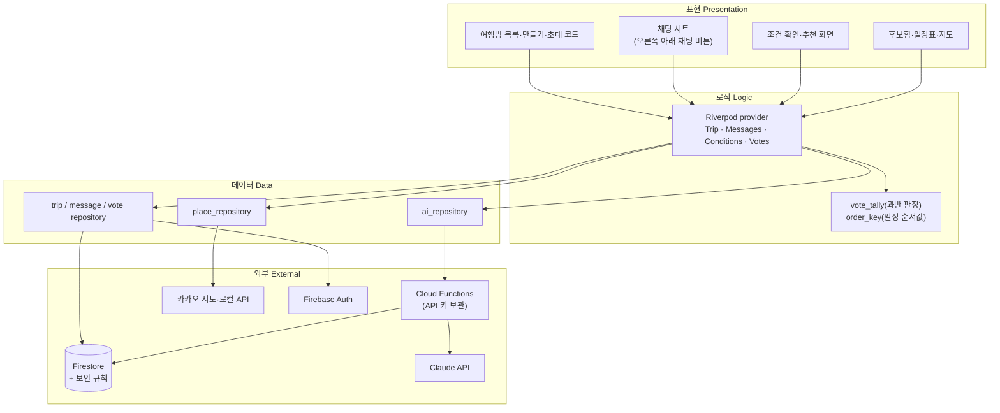

# Week 07 팀 활동지 / Team Activity

| 팀명 / Team | 작성일 / Date | 참여자 / Members |
|---|---|---|
|패트와매트|2026.10.14|김현우, 박영욱|

## 1. 아키텍처 다이어그램 / Architecture Diagram

손그림 사진을 올리고 링크하십시오 / Upload a photo and link it.

<!-- 손그림 사진을 찍어 img/week-07-arch.png 로 올린 뒤 아래 줄의 주석을 풀어 주세요. 아래 Mermaid 그림을 보고 그리면 됩니다. -->
<!--  -->

| 계층 / Layer | 모듈·파일 / Modules | 의존하지 않는 것 / Does not depend on |
|---|---|---|
| 표현 / Presentation | trip_list_screen(내 여행방 목록), create_trip_screen·join_trip_screen(여행방 만들기, 6자리 초대 코드 참여), chat_sheet(어느 화면에서나 오른쪽 아래 버튼으로 여는 채팅 시트, 조건 바, 투표 카드), conditions_screen(조건 확인·수정, 근거 메시지 표시), recommend_screen(추천 3곳과 맞는 조건 수), candidates_screen(후보함, 찬반 투표·댓글), schedule_screen(일차별 타임라인과 지도), app_theme | Firestore 문서 구조, Claude 프롬프트와 응답 JSON, 카카오 API 응답 형식 |
| 로직 / Logic | Riverpod provider(AuthState, TripProvider, MessagesProvider(StreamProvider), ConditionsProvider, RecommendationsProvider, VotesProvider), condition_trigger(새 메시지가 일정 수 쌓이거나 '조건 정리'를 누르면 조건 추출 요청), vote_tally(과반 찬성 판정, 방장 확정), order_key(일정 순서를 실수 값으로 매겨 동시 편집 충돌 줄이기) | 화면 구성(위젯), Firebase SDK 직접 호출, HTTP 요청 방식 |
| 데이터 / Data | auth_repository(Firebase Auth Google 로그인), trip_repository·message_repository·vote_repository(Firestore 읽기·쓰기와 실시간 구독), ai_repository(Cloud Functions의 extractConditions·recommendDestinations 호출), place_repository(카카오 로컬 장소 검색) / 서버: Cloud Functions(Claude API 호출, API 키는 시크릿에만 보관), Firestore 보안 규칙(여행방 멤버만 읽기·쓰기) | 화면, 투표·확정 규칙, 조건을 언제 정리할지에 대한 규칙 |

## 2. 이슈 / Issues

> 이슈 = **앞으로 할 일** / An issue is work to be done.
> 개발할 때 커밋에 이슈 번호를 붙이고(`#3 알레르기 필터 추가`), 완료 조건을 만족하면 이슈를 닫습니다.
> Add the issue number to commits, and close the issue when its criteria are met.

| # | 제목 / Title | 라벨 / Label | 담당 / Assignee | 완료 조건 / Acceptance Criteria |
|---|---|---|---|---|
| #1 | 데이터 구조와 보안 규칙 | backend | 김현우 | 여행방·멤버·메시지·조건을 저장할 수 있고, 멤버가 아닌 계정으로 여행방 문서와 메시지를 읽으면 permission-denied가 난다 |
| #2 | 로그인과 여행방 만들기·초대 코드 참여 | frontend | 박영욱 | 기기 2대에서 한 명이 방을 만들고 다른 한 명이 6자리 코드를 입력하면 두 화면의 멤버 목록에 2명이 보인다 |
| #3 | 실시간 채팅과 채팅 시트 | frontend | 박영욱 | 한 기기에서 보낸 메시지가 3초 안에 다른 기기에 보이고, 후보함·투표 화면에서 오른쪽 아래 버튼으로 채팅을 열고 X로 닫으면 보던 화면으로 돌아온다 |
| #4 | Claude 호출 Cloud Function | backend | 김현우 | APK에서 API 키 문자열이 검색되지 않고, 앱에서 함수를 호출하면 정해진 JSON 형식으로 응답이 온다 |
| #5 | 채팅 기반 여행 조건 추출 | backend | 김현우 | 시연용 메시지 4개를 보내면 30초 안에 조건 바에 날짜·기간, 인원, 이동수단, 예산, 하고 싶은 것이 근거 메시지와 함께 표시되고, 대화에 없는 출발지는 '확인 필요'로 표시된다 |
| #6 | 조건 확인·수정 화면 | frontend | 박영욱 | 예산을 20만원에서 25만원으로 고치고 나갔다 들어와도 25만원이 유지되고, 다른 멤버 화면에도 25만원이 보인다 |
| #7 | 기본 추천과 조건 기반 여행지 추천 | backend | 김현우 | 조건이 없는 방에는 기본 추천 3곳이 뜨고, 조건 확인 후 추천을 누르면 15초 안에 3곳이 맞는 조건 수(예: 6/6)와 이유 한 줄과 함께 표시된다 |
| #8 | 채팅 속 여행지 투표와 확정 | frontend | 박영욱 | 추천 3곳이 투표 카드로 채팅에 올라오고 3명이 투표한 뒤 방장이 확정하면 5초 안에 모든 기기의 여행방 제목 옆에 여행지가 표시된다 |
| #9 | 후보함: 장소 담기·찬반 투표·댓글 | frontend | 박영욱 | 카카오 장소 검색으로 장소 3곳을 담고 3명이 투표하면, 찬성이 과반인 장소에만 '확정 가능' 배지가 붙는다 |
| #10 | 일정표와 지도 동선 | frontend | 김현우 | 확정 가능 장소를 2일 차로 옮기면 지도에 번호 마커와 선이 생기고, 두 사람이 동시에 순서를 바꿔도 두 기기에 같은 순서가 보인다 |
| #11 | 오류·오프라인 처리 | data | 김현우 | AI 호출이 실패하거나 20초가 넘으면 안내 문구가 뜨고 채팅은 계속 되며, 비행기 모드에서도 마지막으로 본 채팅과 일정표가 보인다 |
| #12 | APK 빌드와 README | docs | 박영욱 | 릴리스 APK를 새 기기에 설치하면 #2~#10이 동작하고, README에 아키텍처 그림과 시연 GIF가 있다 |

## 3. 마일스톤 / Milestones

| 마일스톤 / Milestone | 마감 / Due | 포함 이슈 / Issues |
|---|---|---|
| MVP 완료 | 11주차 | #1, #2, #3, #4, #5, #6, #7, #8 |
| 실행 패키지 | 13주차 | #9, #10, #11, #12 |

> AI를 사용했다면 `PROMPTS.md`에 기록 / Log any AI use in `PROMPTS.md`
